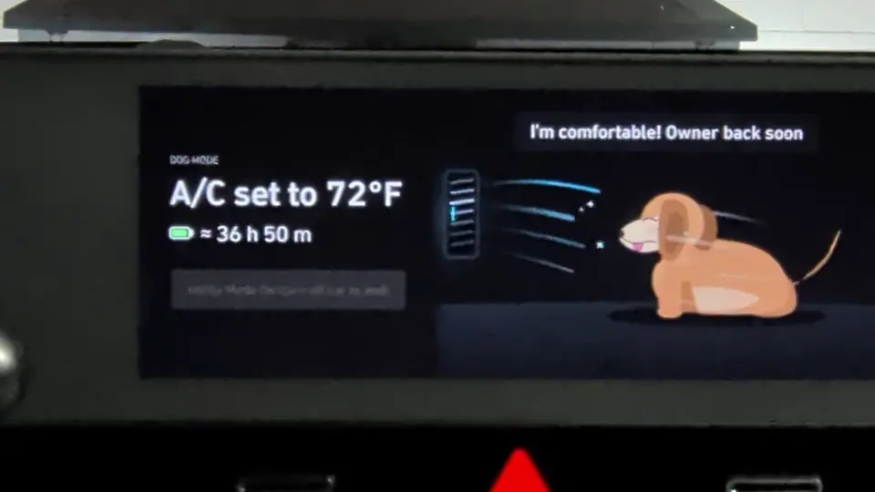

# Sambok: The Missing Dog Mode



My goal with Sambok is to create the "Dog Mode" that my car _should_ have. I've tested it with my 2023 Ioniq 5, and it should work with other Android-based Gen5W vehicles that are compatible with [NEMESIS](https://github.com/xwtk/hmg_nemesis).

> [!CAUTION]
> Sambok is a nice UI wrapper for the car's built-in utility mode. As such, it has all of the same downsides, and potentially introduces extra failure modes. Do not use this software in any sort of safety critical context. It may misbehave, brick your head unit, or kill your entire family.

## Why should I use it?

Compared to the car's stock utility mode, Sambok has these features:

* Inform passers-by that the A/C is on and display the set temperature

* Activate utility mode and set the battery discharge limit on the same screen. No more digging through multiple layers of unintuitive menus

* Measure the car's realtime power consumption to estimate remaining battery runtime

* More useful status messages when Utility mode is unavailable

* EXPERIMENTAL OPTION: Auto-unlock when returning to your car, based on Bluetooth proximity.


## Any downsides?

Because Sambok is built on Hyundai's utility mode, it shares some of the same limitations:

* You can turn it on with a button press, but to turn off utility mode you have to power cycle the car

* The key fob's lock/unlock buttons still do not work while the car is in utility mode


## Installation

Download `sambok.zip` from Releases and place it in the `packages/` folder on a FAT32 or exFAT USB drive (e.g. `packages/sambok.zip`).

* **Via NEMESIS Manager**: Open Manager on the head unit and install Sambok from your USB drive.
* **Direct install on USB insertion**: Place a `NEMESIS.data` file at the root of your USB drive:
  ```ini
  [nemesis]
  version=1.0
  type=install
  path=packages/sambok.zip
  ```


## Usage

1. Open the app. Make sure the battery estimate will cover the time you'll be out of the car.

1. Enable utility mode.

1. Use the lock button in the car to lock all the doors.

1. Exit the car, and use the keyblade to re-lock the door you just opened

1. When you return, use the keyblade to unlock your car

### Key management alternatives

One alternative approach for locking the car is to roll down the window, hit the lock button from outside, roll up the window, and pull your arm out before it gets stuck. I do not recommend this approach, because it's possible to forget your key in the car.

As an experimental alternative, Sambok also supports Bluetooth presence for unlocking the car. If you use this feature, choose a paired Bluetooth device to monitor before starting utility mode. Walk away from your car to arm the unlocking feature (It's based on signal strength. With my phone, walking away about 20 ft is enough). You must stay away from the car for 15 seconds. Once you return to the car, it _should_ unlock automatically. I've only tested this feature a few times, and only with one Bluetooth device. You MUST always have your key with you as a backup. Even if the auto-unlock feature works 100% of the time (no promises), you don't want to be locked out when your phone battery dies.

Once the Bluetooth auto-unlocking is more battle-tested, I'd like to support auto-locking with some reasonable failsafes (force-unlock after a set amount of time?).


## Architecture

The codebase has no external dependencies or Gradle wrapper; it compiles directly against `android.jar` using the Android SDK build-tools:

- [`src/pure/`](src/pure/) — Pure Java logic ([`AutoUnlock.java`](src/pure/AutoUnlock.java), [`Countdown.java`](src/pure/Countdown.java), [`Estimate.java`](src/pure/Estimate.java), [`Setpoint.java`](src/pure/Setpoint.java), [`Units.java`](src/pure/Units.java)) with zero Android dependencies so it runs directly on the host JVM for unit testing.
- [`src/car/`](src/car/) — Vehicle and hardware integration:
  - [`CarClient.java`](src/car/CarClient.java) & [`CarState.java`](src/car/CarState.java) talk to `com.hkmc.micom.datc` (`IDATCService`), `com.hkmc.micom.hev` (`IHEVService`), `com.hkmc.micom.system` (`ISystemService`), and `com.hkmc.micom.bcm` (`IBCMService`). Writes only Utility Mode activation, discharge limit settings, and door unlocks.
  - [`BluetoothMonitor.java`](src/car/BluetoothMonitor.java) monitors paired Bluetooth connection status and polls live RSSI.
- [`src/app/`](src/app/) — Single-screen UI ([`SambokActivity.java`](src/app/SambokActivity.java)) and custom widgets like [`RssiBarView.java`](src/app/RssiBarView.java).
- [`assets/scene.svg`](assets/scene.svg) — Vector dog scene using native SVG 1.1 SMIL animations (`<animateTransform>` / `<animate>`) compatible with KitKat's Chromium 30 `WebView`.

## Build, Test & Package

Requires a JDK (8+) and the Android SDK with `build-tools` (set `ANDROID_HOME` or `ANDROID_SDK_ROOT`).

Run the unit and package test suite:

```sh
./tests/run.sh
```

Build the signed APK (`build/sambok.apk`):

```sh
./build.sh
```

Build the NEMESIS package (`dist/sambok.zip`):

```sh
./tools/make_package.sh
```

Copy `dist/sambok.zip` into `packages/sambok.zip` on a FAT32 or exFAT NEMESIS USB drive to install on the head unit.

## Boring But Important Disclaimer

Sambok is an independent, open-source project and is not affiliated, associated, authorized, endorsed by, or in any way officially connected with Hyundai Motor Company, Kia Corporation, or any of their subsidiaries or affiliates. All product and company names (including Hyundai, Kia, and Ioniq) are trademarks™ or registered® trademarks of their respective holders. Use of them does not imply any affiliation with or endorsement by them.

